<p align="center">
  
</p>

<h1 align="center"><a href="https://alokakki.github.io/WhatsLens/">ChatLens — Offline Chat Viewer</a></h1>

<p align="center">
  <a href="https://alokakki.github.io/WhatsLens/"><b>Open the app →</b></a><br>
  <code>https://alokakki.github.io/WhatsLens/</code>
</p>

---

> Open exported WhatsApp chats on your computer in a clean, WhatsApp-style viewer — with search, calendar jump, insights, heatmap, image zoom and WhatsApp-style PDF export. **100 % offline: nothing is ever uploaded.**

Developed by [@alokakki](https://github.com/alokakki)

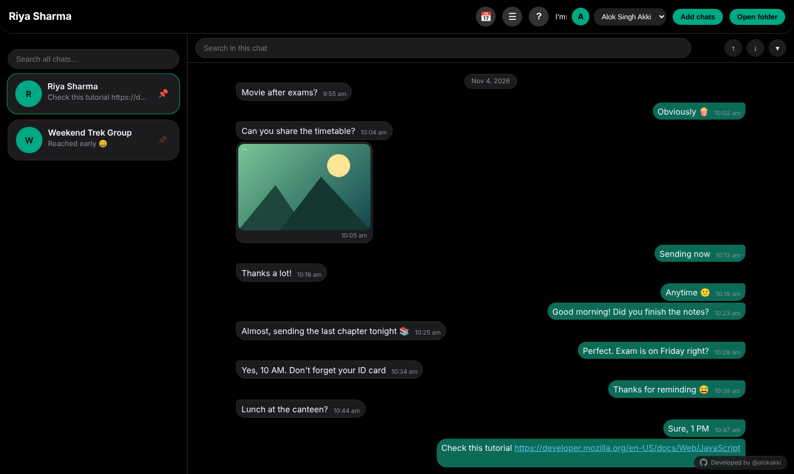

---

## Table of contents
1. [Why ChatLens](#why-chatlens)
2. [Features](#features)
3. [Quick start](#quick-start)
4. [Tutorial: export a chat from WhatsApp](#tutorial-export-a-chat-from-whatsapp)
5. [Tutorial: load chats and media](#tutorial-load-chats-and-media)
6. [Using the app](#using-the-app)
7. [Privacy](#privacy)
8. [Troubleshooting & limits](#troubleshooting--limits)
9. [Project structure](#project-structure)
10. [Host it on GitHub Pages](#host-it-on-github-pages)
11. [Roadmap](#roadmap)
12. [License](#license)

---

## Why ChatLens
WhatsApp can export a chat as a plain `.txt` (or a `.zip` with media), but the file is hard to read and search. ChatLens turns those exports into a familiar chat screen you can browse on a desktop — no install, no server, no account.

## Features

| Area | What you get |
|---|---|
| **Chat folder** | Load many chats at once (files or a whole folder). Chat list on the left, selected chat on the right. Pin favourites with 📌. |
| **WhatsApp look** | Green/white bubbles, day chips, timestamps, group sender colours. Black, Dark grey and Light themes, adjustable font size. |
| **You are "me"** | Your own messages appear on the right. Pick the name from the **I'm** menu (an avatar shows your initial). |
| **Search all chats** | One box searches every loaded chat; results show chat, date and highlighted snippet. |
| **Search inside a chat** | Highlighted matches, `↑` `↓` to step, match counter, and a **▾ dropdown of every match** to scroll and click. |
| **Calendar jump** | Mini calendar with month & year dropdowns; days with messages are highlighted. Click the date chip or 📅. |
| **Friendly dates** | *Today*, *Yesterday*, *12 Mar 2024* — no day/month confusion. |
| **Insights** | Who texts more, busiest hours, messages per month, longest silences, most-used words and emojis. |
| **Activity heatmap** | GitHub-style yearly grid; click a coloured day to jump to it. |
| **Image preview** | Compact previews in the chat; click to enlarge, **scroll to zoom**, drag to pan, double-click to zoom, **⤓ Download**. |
| **Clickable links** | URLs in messages are clickable. |
| **Export** | Pick a date range (or only your search results) → save as **text** or **PDF** that looks like the WhatsApp chat, **with a timestamp on every message**. |
| **Resume reading** | Reopens each chat where you stopped. Pins, theme and position are saved in your browser. |
| **Built for big chats** | Messages and media load lazily; older messages appear as you scroll up. |
| **Help button** | The **?** button explains everything inside the app. |

### Screenshots

| | |
|---|---|
| 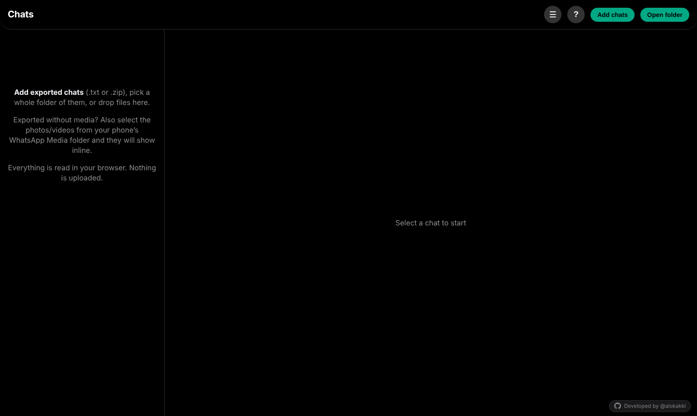 **Start screen** | 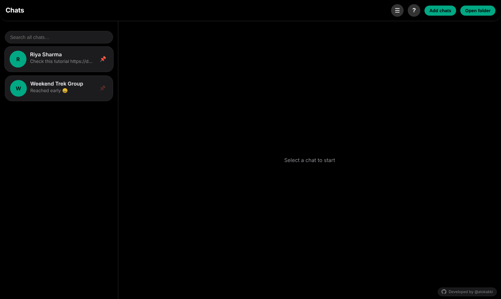 **Chat folder with pins** |
| 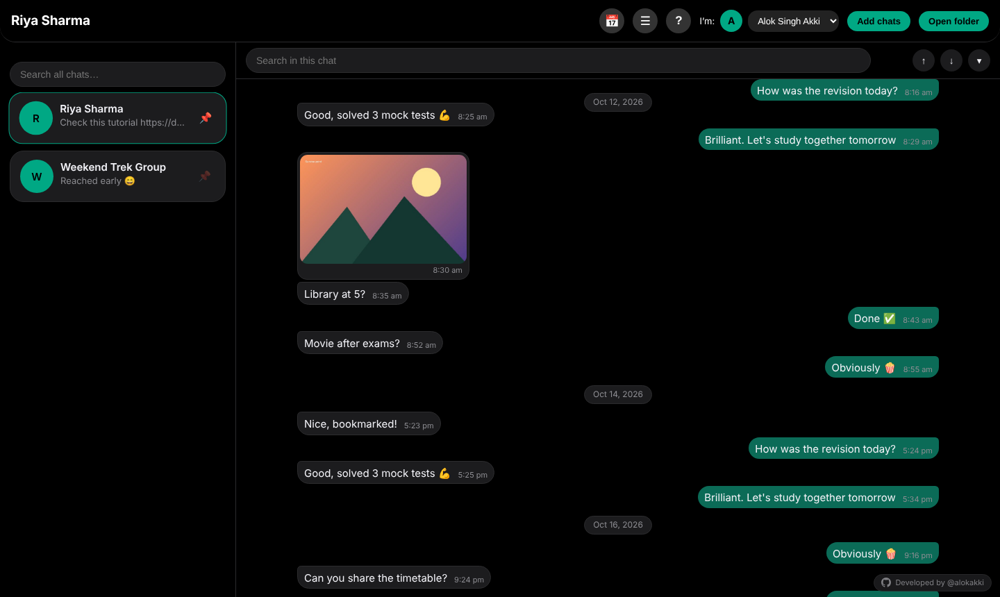 **Compact image preview** | 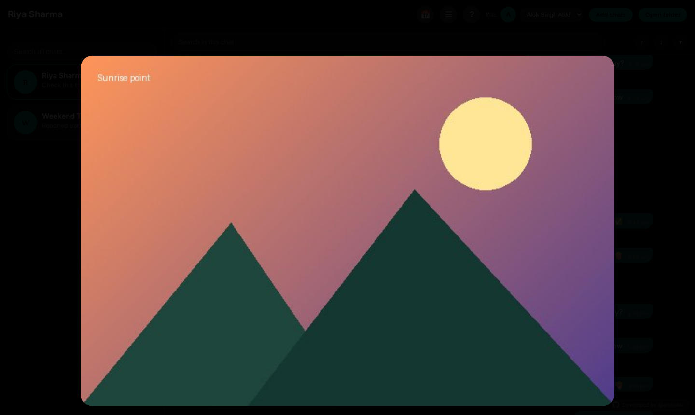 **Zoom, pan and download** |
| 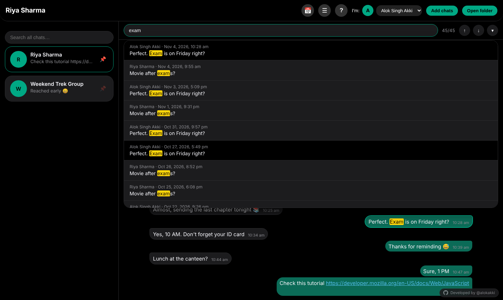 **In-chat search with match dropdown** | 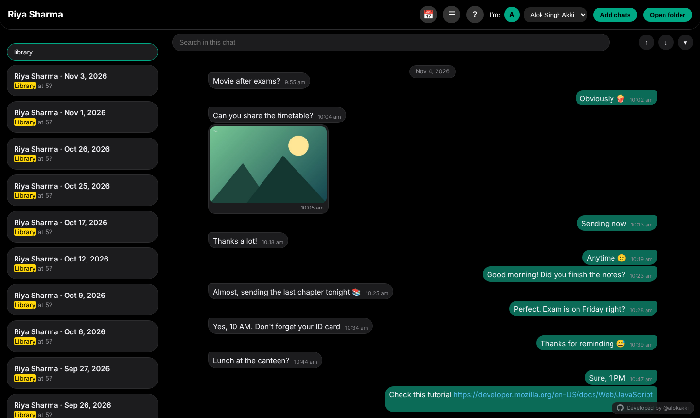 **Search across all chats** |
| 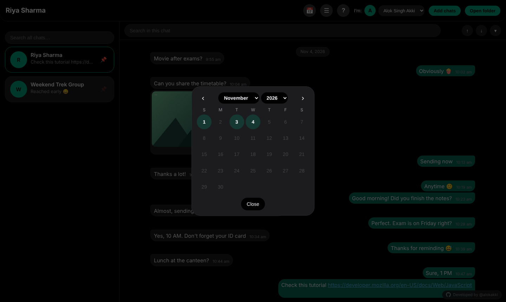 **Calendar jump** | 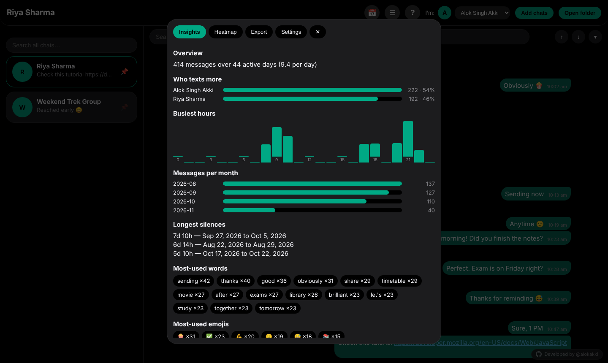 **Chat insights** |
| 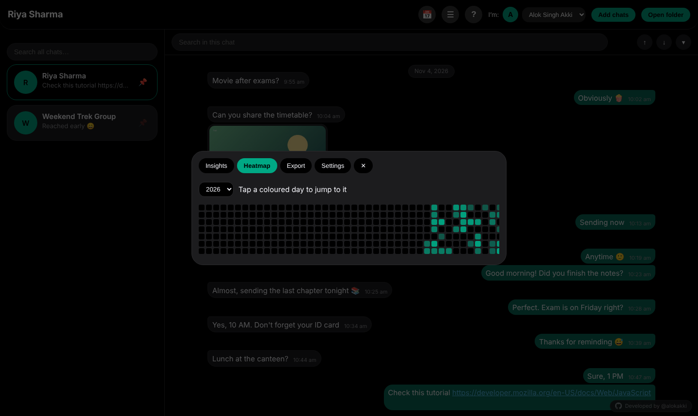 **Activity heatmap** | 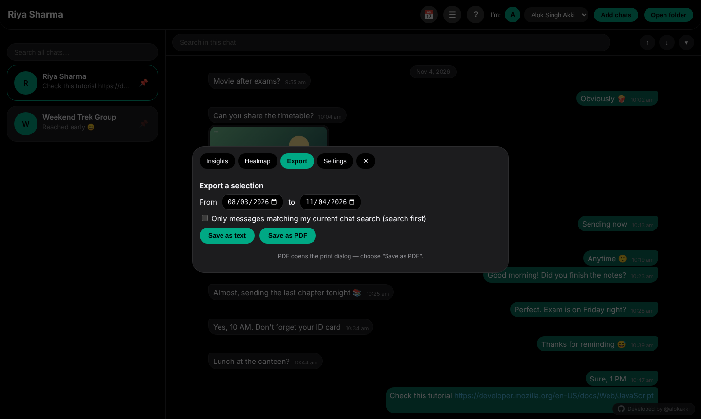 **Export a selection** |
| 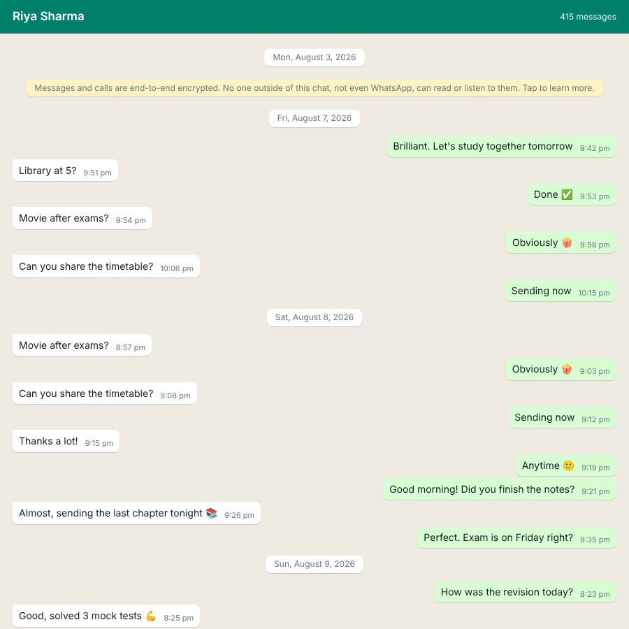 **WhatsApp-style PDF with timestamps** | 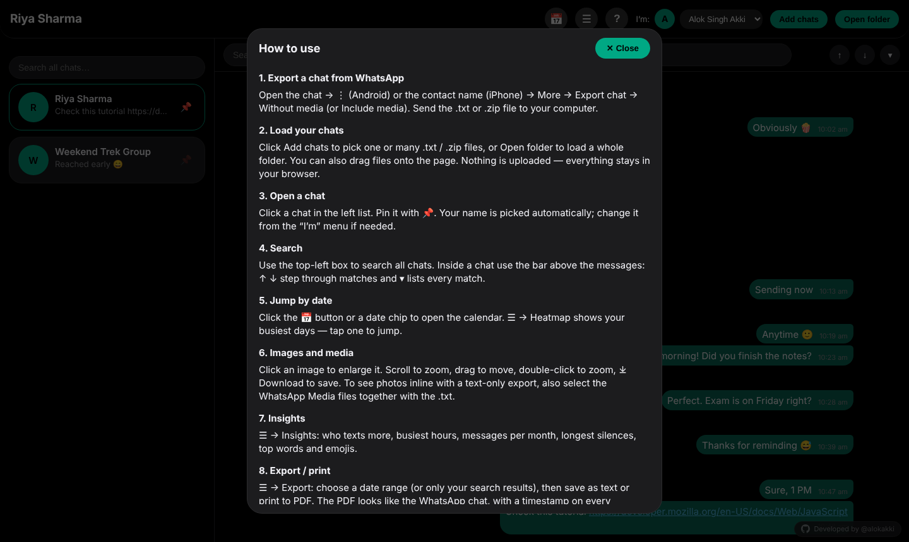 **Built-in instructions** |
| 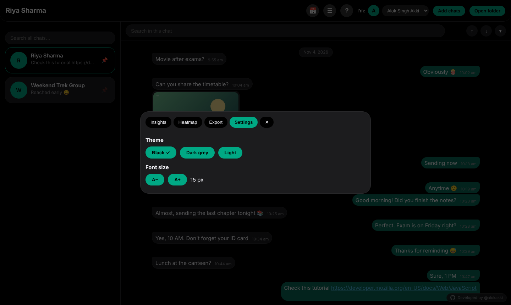 **Settings** | 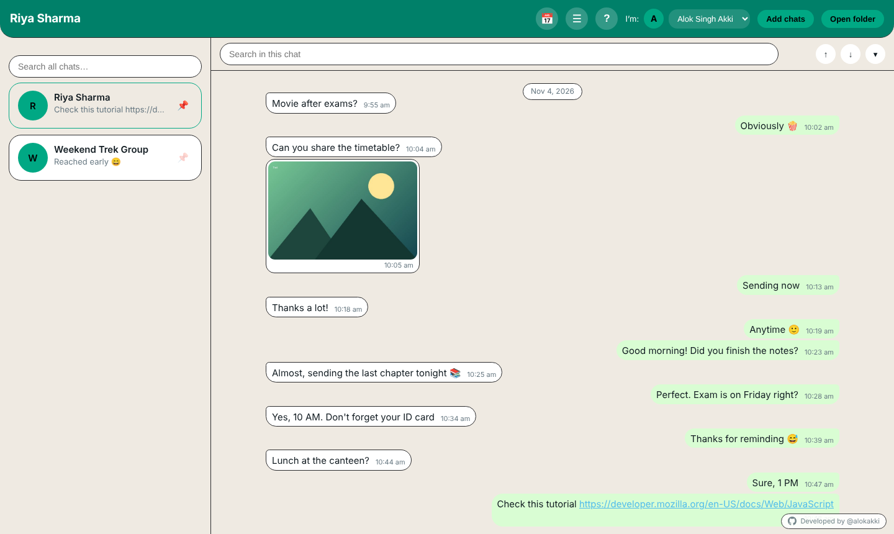 **Light theme** |

> The screenshots use the fake sample chats in [`sample/`](sample/).

## Quick start
1. Download or clone this repository.
2. Double-click **`index.html`** (Chrome, Edge, Firefox or Safari).
3. Click **Add chats** and choose a WhatsApp export (`.txt` or `.zip`) — or try the files in `sample/`.

No build step, no dependencies to install (JSZip is bundled in `lib/`).

## Tutorial: export a chat from WhatsApp
You export **one chat at a time** from your phone.

### Android
1. Open the chat.
2. Tap **⋮ (More options) → More → Export chat**.
3. Choose **Without media** (recommended, small and reliable) or **Include media**.
4. Send the file to your computer (Gmail to yourself, Google Drive, "Save to Files", USB…).

### iPhone
1. Open the chat and tap the **contact or group name** at the top.
2. Scroll down and tap **Export Chat**.
3. Choose **Without Media** or **Attach Media**.
4. Share it to **Save to Files**, AirDrop, Mail, etc.

You will receive either `WhatsApp Chat with <name>.txt` or a `.zip` containing the `.txt` plus media.

> WhatsApp limits exports to roughly the latest 40,000 messages without media (about 10,000 with media).

### "Unable to export your conversation — try exporting without media"
This happens when the media is too large or the phone is low on storage. Use one of these:
- **Export without media** (always works), then add media separately (below).
- Free up phone storage and retry, or export to Google Drive instead of a chat app.

## Tutorial: load chats and media
1. Open `index.html`.
2. Click **Add chats** → select one or many `.txt` / `.zip` files. Or click **Open folder** to load everything in a folder. You can also drag-and-drop files onto the page.
3. Your chats appear in the left list. Click one to open it.

**Adding photos to a text-only export (Android):**
1. Connect the phone by USB (File transfer).
2. Copy `Android/media/com.whatsapp/WhatsApp/Media/` (Images, Video, Voice Notes) to your computer.
3. In ChatLens choose **Add chats** and select the exported `.txt` **together with** the media files, or use **Open folder** on a folder that contains both.

ChatLens matches media by file name (e.g. `IMG-20261012-WA0001.jpg`). This works when the export text contains file names (exports made *with* media). A text-only Android export may say `<Media omitted>`, which has no file name to match.

**Try it now:** select the two `.txt` files and the three images in [`sample/`](sample/).

## Using the app
- **Open a chat** – click it in the left list. Pin with 📌.
- **Search all chats** – top-left box. Click a result to jump to that message.
- **Search in a chat** – bar above the messages. `Enter` = older match, `Shift+Enter` = newer. **▾** lists all matches.
- **Jump to a date** – click the pinned date chip or **📅**, pick month/year from the dropdowns, click a highlighted day.
- **☰ menu** – *Insights*, *Heatmap*, *Export*, *Settings*.
- **? button** – opens the usage guide only (nothing else lives behind it).
- **Images** – click to enlarge; mouse wheel zooms toward the cursor; `+`/`−` buttons; drag to move; double-click to zoom; `Esc` to close.
- **Export / print** – ☰ → Export → choose dates (and optionally *only my search results*) → **Save as text** or **Save as PDF** (your browser's print dialog opens — choose *Save as PDF*; allow pop-ups).

## Privacy
Everything runs in your browser. Files are read locally and **never uploaded**. Settings (pins, theme, reading position) are stored only in your browser's `localStorage`.

## Troubleshooting & limits
| Problem | Fix |
|---|---|
| Chat shows no messages | The export format wasn't recognised. Open an issue with the first two lines of the file (hide names/numbers). |
| Dates look swapped (day ↔ month) | ChatLens detects the format from the whole chat. If every date has day ≤ 12 it assumes **day first**. |
| A very large `.zip` is slow | Use the text-only export and add media separately. |
| PDF window doesn't open | Allow pop-ups for the page. |
| Quoted replies aren't shown | WhatsApp exports don't include reply information. |
| Last-read position is off after re-exporting | Positions are saved per chat name and message number. |

## Project structure
```
chatlens/
├── index.html          # the whole app (HTML + CSS + JS)
├── lib/jszip.min.js    # reads .zip exports (MIT / GPLv3)
├── sample/             # fake demo chats and images
├── docs/
│   ├── images/         # screenshots used in this README
│   └── ChatLens-Documentation.docx   # Word version (with placeholders)
├── LICENSE
└── README.md
```

## Host it on GitHub Pages
1. Push this folder to a GitHub repository.
2. **Settings → Pages → Build and deployment →** *Deploy from a branch* → `main` / `(root)`.
3. Your viewer is live at `https://<your-username>.github.io/<repo-name>/`.

Files you open are still processed only in the visitor's browser.

## Roadmap
Media gallery tab · remember loaded chats between visits · filters by sender/type · starred messages · keyboard shortcuts.

## License
MIT — see [LICENSE](LICENSE). Bundled JSZip is dual-licensed MIT / GPLv3 (see `lib/JSZIP-LICENSE.md`).

---
<p align="center"><a href="https://github.com/alokakki">Developed by @alokakki</a></p>

*ChatLens is an independent tool and is not affiliated with or endorsed by WhatsApp or Meta.*
